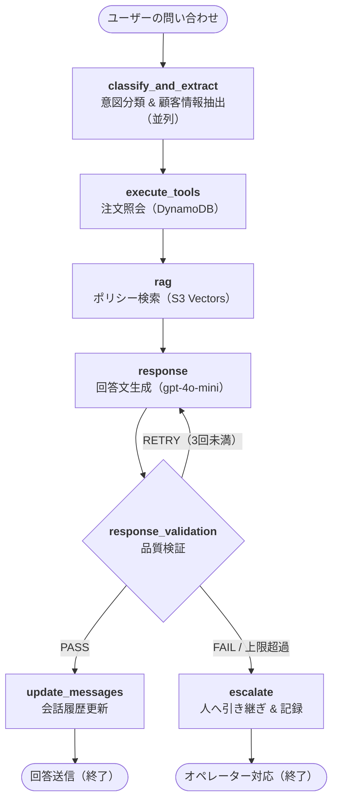

# カスタマーサポート Agent

**[日本語 (README.md)](./README.md#japanese) | [English in README.md](./README.md#english)**

---

# カスタマーサポート Agent

ポリシーに沿った回答と、必要なときだけ人へ渡すことを目的にした、個人開発のカスタマーサポート AI Agent です。

LLM に全部任せるチャットボットではなく、**分類 → 情報抽出 → 注文照会 → ポリシー検索 → 回答生成 → 品質検証 → エスカレーション** を LangGraph のパイプラインとして組んでいます。ホスティングは AWS App Runner です。

> デモ用に購入履歴のモックデータを入れています。App Runner 上の公開デモはコストの都合で停止していることがあります。

---

## このプロジェクトの目的

カスタマーサポートは、生成 AI のデモとしてよく出てきます。一方で現場の難しさはうまく話すことではなく **間違えないこと** にあります。

- 返品は「だいたい 1 ヶ月」ではなく **配送後 30 日**
- メール変更は「設定から」ではなく **Settings > Account > Email**
- 不正利用や重要な問い合わせは**スタッフに引き渡す**

最初に試したのは、LLM にツールを持たせて次の行動を自分で選ばせる形（ReAct 型）でした。会話は自然になりますが、サポートでは困ることが多いです。これはリスポンスにかかる時間がかかってしまうだけでなく、注文照会が不要な質問でもツールを呼び、エスカレーションすべき案件を回答してしまうことがあったためです。

そこで方針を変えました。

> **LLM は文章と判定だけを担当する。次にどのノードへ行くか、どのツールを呼ぶかはコードが決める。**

このリポジトリは、その方針で「ポリシー RAG + 注文ツール + 検証 + 人への引き渡し」まで一通り動かす個人プロジェクトです。

扱うカテゴリは次のとおりです。

- Billing / Payment（料金、請求、支払い）
- Subscription（開始・解約・プラン変更）
- Account（ログイン、パスワード、プロフィール）
- Shipping / Delivery（追跡、配送状況）
- Returns / Refunds（返品、返金、破損）
- General（それ以外）

---

## なぜこの構成にしたか

### グラフは 7 ノードの一本道

ノードは 7 つです。条件分岐は検証のあと 1 箇所だけです。

| ノード | 役割 | 誰が決めるか |
|---|---|---|
| `classify_and_extract` | 意図分類と、メール / 名前 / 注文番号の抽出（並列） | LLM |
| `execute_tools` | 注文照会が必要なら DynamoDB を引く | Python（キーワード） |
| `rag` | ポリシー文書を S3 Vectors から取る | 毎回実行（LLM は選ばない） |
| `response` | 顧客向けの回答文を書く | LLM |
| `response_validation` | PASS / RETRY / FAIL | まず Python、足りなければ LLM |
| `update_messages` | 会話履歴に回答を足す | Python |
| `escalate` | 定型文で人へ渡し、記録する | Python |

ReAct にしなかった理由は単純です。サポートでは「何を調べるか」は質問の形からかなり決まります。注文番号や tracking が出ていれば注文 DB、それ以外はポリシー検索、hacked / fraud なら人、です。ここを毎ターン LLM に選ばせると、コストとブレが増えるだけで、ポリシー遵守は良くなりません。

LLM がグラフの遷移を決めるのは、検証ノードが `PASS | RETRY | FAIL` を返したときだけです。ツール選択は function calling ではなく、注文・配送系の語があればツールを呼び、注文 ID の有無で `check_order_status` / `get_order_details` / `lookup_customer_orders` を切り替えます。

### 分類と抽出を並列にした理由

分類と連絡先抽出は互いに必須入力ではありません。直列にすると LLM を 2 回待つことになります。並列に回し、どちらかが落ちても分類は `general`、抽出は空、として先に進みます。

### App Runner 選定理由

個人プロジェクトで EKS は過剰であると判断しました。個人プロジェクトであり、小規模であるため、App Runner で十分であると考えました。

会話のチェックポイントは現状 LangGraph のプロセス内保存です。デモの 1 インスタンスでは足りますが、スケールや再起動では切れます。

---

## 処理の流れ（1 ターン）

1. **分類**  
   `gpt-4o-mini` が JSON で意図を返す（billing / subscription / account / shipping / returns / general）。
2. **抽出**  
   会話から email / name / order_id を抽出する。
3. **ツール**  
   購入・配送関連の問い合わせのときだけ購入履歴テーブルを引く。
4. **RAG**  
   分類タグ付きクエリでポリシーを取得。
5. **生成**  
   ポリシーを原文に近い数字・パス・期限で引用するよう指示する。履歴がある場合は繰り返さない。
6. **検証**  
   必要なら LLM。RETRY は最大 3 回、超えればエスカレーション。
7. **エスカレーション**  
   DynamoDB に理由・分類・試した回答を残し、セキュリティなら緊急の定型文、連絡先が無ければメールを聞く。

---

## Evaluation

「動いた」ではサポート Agent の良し悪しが分かりません。数字・手順・期限がポリシーと一致しているかを、LangSmith 上でデータセットに対して測るようにしました。

実行時の検証（甘い PASS/RETRY）と、オフライン評価（厳しい LLM-as-judge）は意図的に別物です。

### やり方

1. LangSmith データセット `eval_set` の各例を読む
2. 毎回新しい `thread_id` で LangGraph を 1 ターン実行する（`/chat` は通さない）
3. 出力 `response` を 2 つの evaluator に渡す
4. 実験名 `response-eval-llm-judge` として記録する

### 回答品質の 3 指標（LLM-as-judge）

Judge モデルは **gpt-4o**（temperature 0）。生成側の gpt-4o-mini より一段上のモデルに、参照回答付きで 0–10 を付けさせ、平均を 0–1 に正規化します。

| 指標 | 見ていること | 減点の例 |
|---|---|---|
| **Policy Accuracy** | ポリシーからの逸脱がないか | セルフサービスなのに「サポートへ連絡」、期限の言い換え（5–7 日を 1–3 日） |
| **Specificity** | 次の行動が具体か | 「設定から」止まりでパスが無い、`soon` などの曖昧語 |
| **Completeness** | 解決に必要な情報が揃っているか | 写真提出・確認メール・対象外条件の欠落 |

### データセットサンプル

| # | 質問の要旨 | 参照ポリシー | 期待 | エスカレーション |
|---|---|---|---|---|
| 1 | 返品期限 | Customer Support | 配送後 30 日 | いいえ |
| 2 | ギフトカードは返せるか | Customer Support | 不可 | いいえ |
| 3 | 壊れて届いた | Customer Support | 48 時間以内に写真、即交換 | いいえ |
| 4 | 電話サポート時間 | Customer Support | 平日 9–5 EST | いいえ |
| 5 | 感謝祭は開いているか | Customer Support | 電話・チャット休み、メールは 24/7 | いいえ |
| 6 | Premium のメール返信時間 | Customer Support | 1 時間未満 | いいえ |
| 7 | ログイン失敗でロック？ | Account Management | 5 回失敗、30 分 | いいえ |
| 8 | メール変更方法 | Account Management | Settings > Account > Email | いいえ |
| 9 | アカウントをハックされた | Account Management | `security@company.com`、PW、2FA | **はい** |
| 10 | Basic の年額 | Billing & Payment | $99.99 / 年 | いいえ |
| 11 | サブスクは自動更新か | Subscription | オプトアウトしない限り自動 | いいえ |
| 12 | 解約で今月分は返るか | Subscription | 日割りなし、期末まで利用可 | いいえ |
| 13 | Express の日数 | Shipping & Delivery | 1–2 営業日 | いいえ |
| 14 | Premium の critical が 3 日未解決 | Customer Support | SLA は 24 時間 | **はい** |
| 15 | メキシコ配送の例外をお願い | Shipping & Delivery | 対象地域外 | **はい** |

見ている失敗パターンは 3 種類です。

- **事実の取り違え**（期限、料金、パス）
- **例外の取り扱い**（ギフトカード不可、日割り返金なし）
- **人に渡すべき案件**（侵害、SLA 超過、ポリシー外の例外願い）

### 改善の履歴

同じ評価セットを回しながら、グラフ構造は変えず、検索とプロンプトだけを変えました。

| 回 | スコア | 何をしたか | 分かったこと |
|---|---|---|---|
| 1. ベース | **0.59** | 生成 + 小さめ RAG | 返事は丁寧だが「設定からどうぞ」で終わる。期限とパスが落ちる。k が小さく、関連チャンクを取りこぼす |
| 2. RAG | **0.70**（+19%） | k=3→5、チャンク 1000→1500 | ポリシー本文がプロンプトに載るようになり、数字は出る。まだ言い換えが残る |
| 3. プロンプト | **0.74**（ベース比 +25%） | 期限・連絡先・画面パスを原文のまま書く、言い換えない、と明示 | Specificity と Policy Accuracy が上がる。セルフサービス案内を「サポートへ」に逃がしにくくなる |

グラフを複雑にするより、**渡す文脈を厚くし、引用ルールを厳しくする**方が、このタスクでは効きました。0.74 は「改善は出ているが、ポリシー厳格運用の目安には届いていない」と考えています。

---

## 技術スタック

| 層 | 選択 | 理由 |
|---|---|---|
| オーケストレーション | LangGraph StateGraph | 分岐と retry をコードで固定できる |
| LLM | gpt-4o-mini（分類・抽出・生成・検証） | レイテンシとコスト。Judge だけ gpt-4o |
| RAG | OpenAI embeddings + S3 Vectors | AWS 内で完結、マネージド |
| 注文・履歴 | DynamoDB | App Runner と相性が良い |
| 評価 | LangSmith | データセットと実験の履歴が残る |
| デプロイ | AWS CDK → App Runner | 個人開発でクラスタを持たない |

実装の配置は次のとおりです。

- `src/agent.py` … グラフ定義と `chat()`
- `src/nodes/` … 各ノード
- `src/prompts.py` … 分類と回答プロンプト
- `src/tools.py` … 注文照会 3 本
- `backend/app/main.py` … `/chat`, `/health`, `/warmup`
- `langsmith/` … 評価スクリプトと CSV
- `infra/` … CDK（App Runner, IAM, Secrets 参照）

英語の概要は [English Section in README.md](./README.md#english)（または [src/README.md](./src/README.md)）にあります。

---

## 今後の課題

個人プロジェクトとして意図的に残している限界です。

- 会話チェックポイントがプロセス内メモリ。複数インスタンスでは `thread_id` だけでは足りない
- 注文 ID 検索はデモ規模
- セキュリティ検知はキーワード検索に依存している
- 評価セットの不足。
- ポリシー PDF の再投入スクリプトとリポジトリ内の文書が揃っていない
