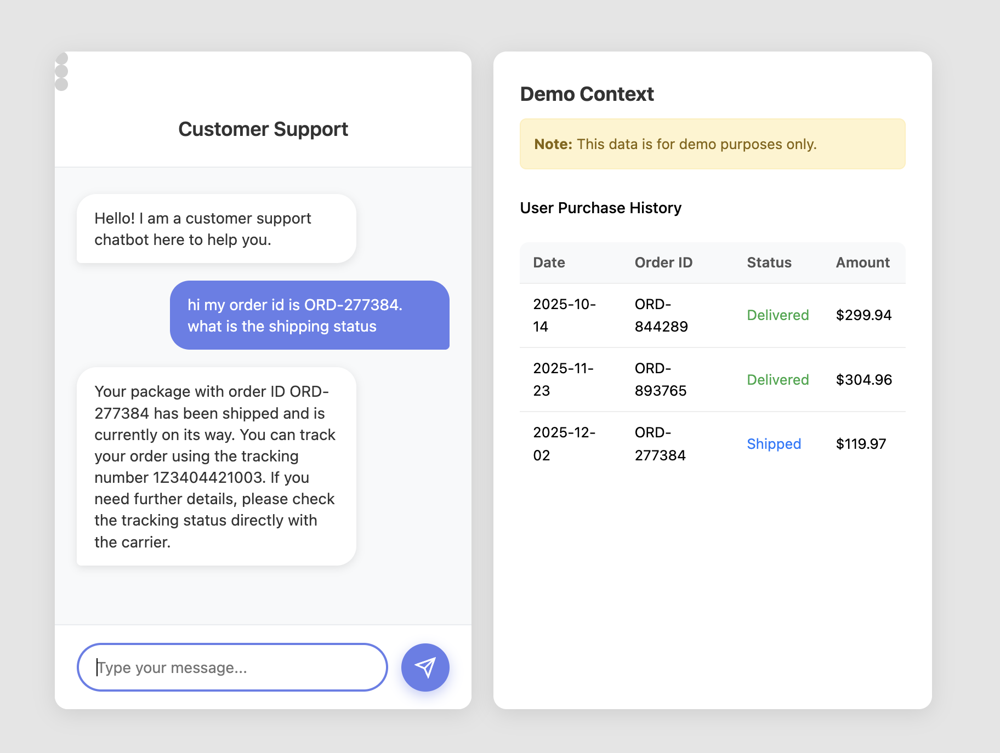
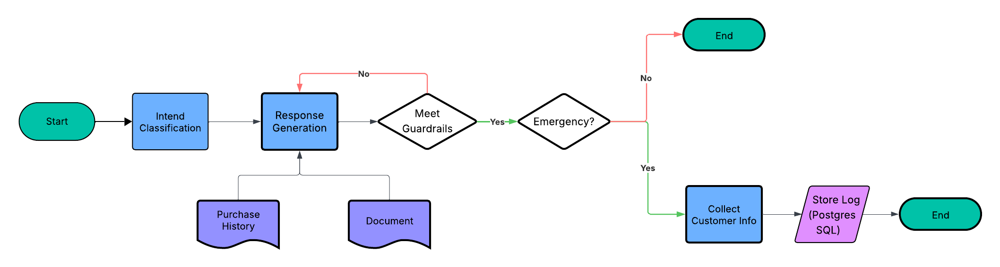
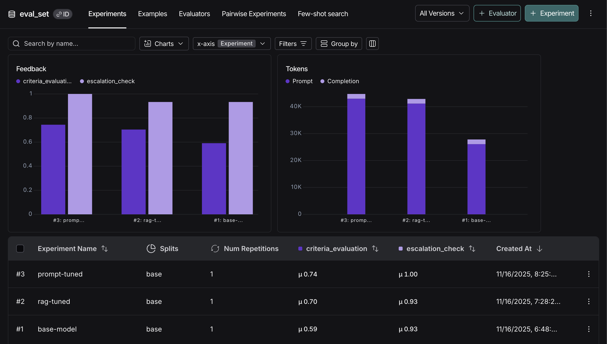
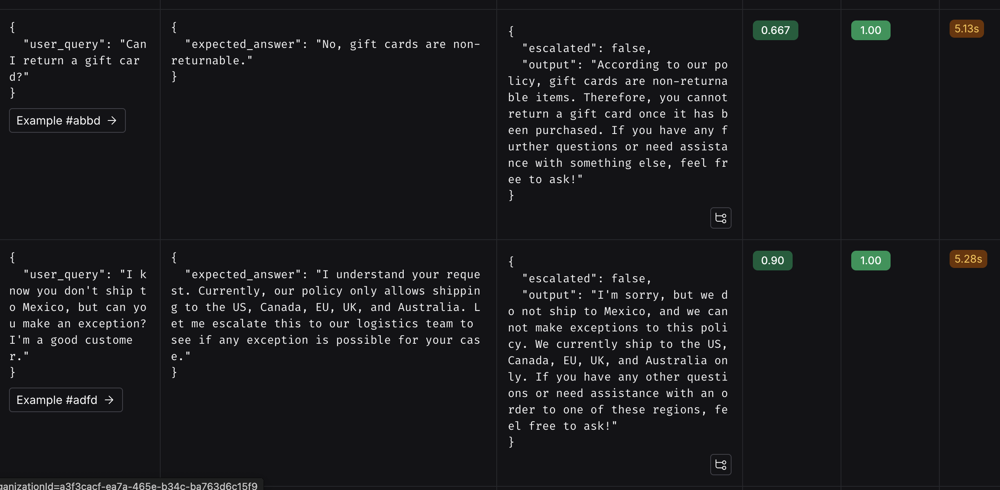
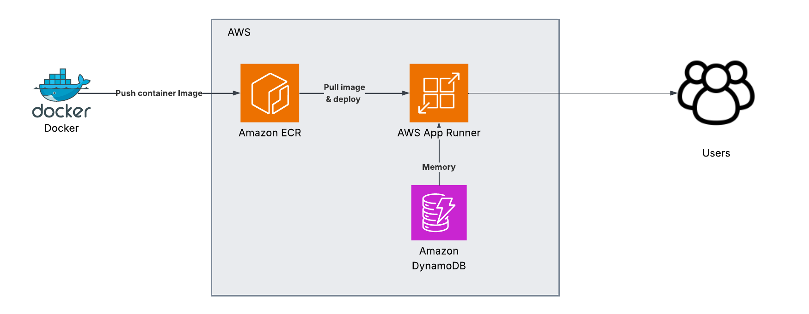

<div id="top" align="center">

# Customer Support Agent / カスタマーサポート Agent

**[English](#english) | [日本語](#japanese)**

</div>

---

<a id="english"></a>

# Customer Support Agent

A customer support AI agent designed to provide strictly policy-grounded answers and escalate to human operators only when necessary.

Rather than relying on an unconstrained LLM to "handle everything", this system executes a deterministic pipeline built with **LangGraph StateGraph**: **Classification → Info Extraction → Order Lookup → Policy RAG → Response Generation → Quality Validation → Escalation**. Hosted serverless on **AWS App Runner**.



> Includes mock purchase history data for demonstration purposes. The live App Runner deployment may periodically be paused to manage hosting costs.

---

## Project Motivation & Philosophy

Customer support is a ubiquitous showcase for Generative AI. However, the real-world operational challenge is not "speaking fluently," but **never providing incorrect information**.

- Returns are not "around a month" — they are strictly **within 30 days of delivery**.
- Changing an email address is not "do it from settings" — the exact UI path is **Settings > Account > Email**.
- Account takeovers and security issues must not be handled with casual chat — they must immediately be **escalated to humans**.

In early iterations, we experimented with a standard ReAct-style agent where the LLM dynamically decides its next step and tool calls. While conversational flow was smooth, it caused numerous failures in support scenarios: invoking order lookup tools for general questions, "trying too hard" to answer issues that should have been escalated, and inventing procedures not grounded in policy.

We therefore pivoted our design philosophy:

> **The LLM is responsible solely for natural language synthesis and evaluation. Code determines which node executes next and which tools are invoked.**

This repository implements that philosophy end-to-end: Policy RAG + Order Lookup Tools + Dual-Layer Validation + Human Escalation.

### Supported Categories:
- **Billing / Payment**: Charges, invoices, payment methods, pricing
- **Subscription**: Onboarding, cancellation, tier changes
- **Account**: Login issues, password resets, profile management
- **Shipping / Delivery**: Tracking, delivery status, courier updates
- **Returns / Refunds**: Returns process, refunds, damaged items
- **General**: Other general inquiries

---

## Architectural Decisions

### 1. Deterministic 7-Node Pipeline

```
classify_and_extract
        ↓
  execute_tools
        ↓
       rag
        ↓
    response
        ↓
response_validation
   ├ PASS  → update_messages → End
   ├ RETRY (< 3 times) → Back to response
   └ FAIL / Max retries exceeded → escalate → End
```

The pipeline contains 7 nodes with only a single conditional branch after response validation:

| Node | Responsibility | Decision Maker |
|---|---|---|
| `classify_and_extract` | Intent classification & extraction of email, name, order ID (in parallel) | LLM |
| `execute_tools` | Queries DynamoDB if order lookup keywords are detected | Python (Rule-based) |
| `rag` | Retrieves policy passages from S3 Vectors | Always runs (Code, not LLM) |
| `response` | Generates customer-facing answer | LLM |
| `response_validation` | Evaluates response: PASS / RETRY / FAIL | Python first; LLM as fallback |
| `update_messages` | Appends response to conversation history | Python |
| `escalate` | Escalates to human with templated message and logs to DB | Python |

**Why not ReAct?**
In customer support, required actions are almost entirely discernible from the query structure. If tracking numbers or order IDs are present, query the order DB; otherwise, search policy documents; if security words appear, escalate. Letting an LLM decide transitions every single turn inflates latency and token costs while increasing variance and policy violations.

The LLM only influences graph transitions when the validation node outputs `PASS | RETRY | FAIL`. Tool invocation avoids LLM function calling; instead, Python rules detect order-related keywords and route between `check_order_status`, `get_order_details`, and `lookup_customer_orders` depending on whether an order ID is present.

### 2. Parallel Classification & Extraction

Intent classification and customer contact extraction are mutually independent. Running them sequentially would incur two consecutive LLM latency penalties. By running them concurrently via `ThreadPoolExecutor`, we minimize per-turn response latency. If either call fails, classification safely defaults to `general` and extraction to empty values.

### 3. Running RAG on Every Turn

Gating RAG based on classification tags means a classification error directly leads to missing information. Instead, we formulate the semantic search query as `{classification_tag} question: {user_message}`. The tag provides domain focus for the vector search, while retrieval itself is never skipped. We use a chunk size of 1,500 characters with 200 overlap and `top_k = 5` (expanded from k=3 / 1,000 characters during offline evaluation).

Policy documents (PDFs) are chunked and stored in S3 Vectors using OpenAI `text-embedding-3-small`. This keeps infrastructure fully serverless and co-located in AWS alongside App Runner without managing a dedicated vector DB cluster.

### 4. Separation of Response Generation and Validation

Asking the same LLM to "write an answer and judge whether it's good" almost always results in confirmation bias (false PASS). Therefore, generation (`gpt-4o-mini`, `max_tokens=300`) and validation are strictly separated into different nodes.

Online runtime validation is intentionally more lenient than offline evaluation:
1. Immediate FAIL & escalation if user message contains security keywords (`hacked`, `fraud`, etc.)
2. RETRY if response is empty, excessively brief, or contains generic "I don't know" phrases
3. Immediate PASS (skipping validation LLM) if classification is `general` and length is adequate
4. Validation LLM evaluates PASS / RETRY / FAIL only for the remaining cases

The online rule is "let non-broken answers pass quickly." Strict judging is offloaded to offline LangSmith evaluation to avoid added latency and premature rejection of partially correct self-service guides.

Furthermore, the generation prompt strictly forbids mentioning escalation. Templated escalation messages belong solely to the `escalate` node. This prevents an infinite retry loop where generation outputs "I will escalate this" and the validation node rejects it as a low-quality policy answer.

### 5. Rule-Based Security Detection

For account takeovers and unauthorized activity, keyword-based deterministic escalation (`hacked`, `fraud`, `unauthorized`, `stolen`) is safer and more reliable than asking an LLM to "reason about danger." While keyword heuristics can produce occasional false positives or miss novel paraphrases, eliminating generative hallucination in security-critical paths was our top design priority. Real authentication and account lockouts remain outside this agent's scope.

### 6. Why AWS App Runner?

Kubernetes (EKS) is excessive overhead for a personal project. AWS App Runner provides zero-maintenance container execution, automatic health checks, and autoscaling. State is persisted in DynamoDB (conversation history, purchase mock data, escalations), secrets in AWS Secrets Manager, and API endpoints are exposed via FastAPI (`/chat`, `/health`). LangGraph is lazily loaded to ensure App Runner health checks pass immediately on cold start.

Conversation checkpointing currently utilizes LangGraph's in-process `MemorySaver`. While adequate for single-instance demos, multi-instance horizontal scaling would require external checkpointer persistence (conversation history is also backed up to DynamoDB as a foundational step).

---

## Request Lifecycle (1 Turn)

1. **Classification**: `gpt-4o-mini` outputs intent as JSON (`billing`, `subscription`, `account`, `shipping`, `returns`, `general`).
2. **Extraction**: Extracts `email`, `name`, and `order_id` from conversation context. Falls back to regex for email if JSON parsing fails.
3. **Tool Execution**: If order-related keywords are detected, queries DynamoDB purchase history. Formats output as `[ORDER/PURCHASE]` in subsequent prompts.
4. **RAG**: Queries S3 Vectors using `{classification_tag} question: {user_message}` to fetch top-5 policy excerpts.
5. **Response Generation**: Generates response strictly referencing exact numbers, navigation paths, and timeframes from retrieved policies. Avoids repetition across history.
6. **Validation**: Evaluates via fast-path Python rules → LLM judge if necessary. Max 3 retries before automatic escalation.
7. **Escalation**: Logs escalation metadata (reason, classification, attempted answer) to DynamoDB. Displays emergency instructions for security issues or prompts for email if missing.

The frontend (`static/index.html`) maintains conversational continuity across turns via `thread_id`.



---

## Evaluation

"It works" is insufficient for a customer support agent. We established an automated offline evaluation pipeline in **LangSmith** to measure fidelity against exact policy numbers, steps, and deadlines.

Runtime validation (lenient PASS/RETRY) and offline evaluation (strict LLM-as-judge) serve fundamentally different purposes.

### Evaluation Workflow

The primary evaluation script is `langsmith/test_response_eval.py`:
1. Reads test cases from LangSmith dataset `eval_set`
2. Executes the LangGraph agent for 1 turn using a fresh `thread_id` (bypassing `/chat` HTTP API)
3. Evaluates output `response` with two independent evaluators
4. Records results under experiment name `response-eval-llm-judge`

A separate classification-only experiment (`test_classification_eval.py`) measures predicted vs. expected label accuracy (0/1).

### 3 Quality Metrics (LLM-as-Judge)

Judge model: **gpt-4o** (temperature 0) — a more capable model than generation's `gpt-4o-mini`. Scores 0–10 against reference answers, normalized to 0.0–1.0:

| Metric | What It Measures | Example Penalties |
|---|---|---|
| **Policy Accuracy** | Fidelity to company policy | Saying "contact support" when self-service exists; paraphrasing timeframes (e.g. "1–3 days" instead of "5–7 days") |
| **Specificity** | Actionability of next steps | Saying "go to settings" without full UI path; using ambiguous terms like `soon` |
| **Completeness** | Inclusion of all prerequisites | Omitting photo requirements, confirmation email steps, or non-refundable exclusions |

In our judge prompt, if a self-service path exists in policy but the model responds "please contact support," Policy Accuracy is penalized to 0–3. Answers that pass online validation will fail here if non-specific.

### Escalation Evaluator (Rule-Based)

The second evaluator does not use an LLM. It verifies whether the ground-truth `escalate` boolean matches the presence of phrases like `escalated to our support team` in the final response (1 = match, 0 = mismatch). This verifies both true positives ("escalated when required") and true negatives ("did not escalate unnecessarily").

### Benchmark Dataset (15 Ground-Truth Cases)

`langsmith/eval_set.csv` tests core policy factuality across all PDF policies, with 3 escalation cases out of 15:

| # | Question Summary | Policy Document | Expected Policy Fact | Escalate? |
|---|---|---|---|---|
| 1 | Return timeframe | Customer Support | 30 days after delivery | No |
| 2 | Can gift cards be returned? | Customer Support | Non-refundable | No |
| 3 | Arrived damaged | Customer Support | Photos within 48h, immediate replacement | No |
| 4 | Phone support operating hours | Customer Support | Weekdays 9 AM–5 PM EST | No |
| 5 | Open on Thanksgiving? | Customer Support | Phone & chat closed, email 24/7 | No |
| 6 | Premium plan email response SLA | Customer Support | Under 1 hour | No |
| 7 | Account lock on failed logins | Account Management | 5 failed attempts, locked for 30 min | No |
| 8 | How to change email address | Account Management | Settings > Account > Email | No |
| 9 | Account was hacked | Account Management | `security@company.com`, password reset, 2FA | **Yes** |
| 10 | Basic plan annual price | Billing & Payment | $99.99 / year | No |
| 11 | Do subscriptions auto-renew? | Subscription | Automatic renewal unless opted out | No |
| 12 | Refund for current month upon cancel? | Subscription | No prorated refund, access until period end | No |
| 13 | Express shipping transit time | Shipping & Delivery | 1–2 business days | No |
| 14 | Premium critical issue open for 3 days | Customer Support | SLA breached (SLA is 24 hours) | **Yes** |
| 15 | Request exception for Mexico delivery | Shipping & Delivery | Outside supported regions | **Yes** |

Tested failure modes include:
- **Fact distortion** (deadlines, pricing, navigation paths)
- **Exception mishandling** (gift card exclusions, no prorated subscription refunds)
- **Escalation boundary cases** (security breaches, SLA violations, policy exception requests)

Extended multi-step reference answers are in `eval_response.csv` (15 cases: double billing, pausing subscription, tax exemption, 35-day late returns, failed transactions). `eval-sample.csv` (~50 rows) tests classification coverage.

### Performance & Improvement History

We tracked iterative improvements on the exact same dataset without modifying graph architecture, isolating the impact of retrieval tuning and prompt constraints:



| Iteration | Score | What Changed | Insights |
|---|---|---|---|
| 1. Baseline | **0.59** | Base generation + minimal RAG | Polite tone, but answers ended with vague "visit settings". Missed deadlines and UI paths. Small k missed relevant chunks. |
| 2. RAG Optimization | **0.70** (+19%) | k=3 → 5, chunks 1000 → 1500 chars (overlap 200) | Full policy text injected into context. Numerical facts improved, but paraphrasing persisted. |
| 3. Prompt Refinement | **0.74** (+25% vs base) | Strict rule: quote exact timeframes, emails, UI paths verbatim without paraphrasing | Significant jump in Specificity and Policy Accuracy. Prevents deflecting self-service to "contact support". |

Conclusion: **Enriching context window density and enforcing strict verbatim citation rules** delivered greater gains than increasing pipeline complexity. 0.74 represents substantial progress, though still below our production threshold of ~0.80. Remaining misses stem from empty vector search fallbacks and subtle wording variations in escalation phrases.

Case-by-case score breakdowns across all metrics are visible in LangSmith:



---

## Tech Stack

| Layer | Choice | Rationale |
|---|---|---|
| Orchestration | LangGraph StateGraph | Deterministic control over branching, retries, and state |
| LLM | `gpt-4o-mini` (classify, extract, generate, validate) | High throughput and cost efficiency; `gpt-4o` reserved for offline Judge |
| RAG | OpenAI Embeddings + S3 Vectors | Serverless, managed vector store within AWS ecosystem |
| State & Tools | AWS DynamoDB | Serverless, low-latency key-value store natively integrated with App Runner |
| API & UI | FastAPI + Static HTML/JS | Single container serves both API and interactive demo UI |
| Evaluation | LangSmith | Versioned evaluation datasets, trace tracking, and LLM-as-judge runs |
| Deployment | AWS CDK → AWS App Runner | Fully managed serverless container hosting without Kubernetes complexity |



### Repository Structure
- `src/agent.py` — Graph definition & `chat()` entrypoint
- `src/nodes/` — Node implementations (`classify_and_extract`, `tools`, `rag`, `response`, `validation`, `escalate`, `update_messages`)
- `src/prompts.py` — Prompt templates for classification and generation
- `src/tools.py` — 3 order lookup tools backed by DynamoDB
- `backend/app/main.py` — FastAPI application (`/chat`, `/health`, `/warmup`)
- `langsmith/` — Offline evaluation scripts and benchmark datasets
- `infra/` — AWS CDK infrastructure definitions (App Runner, IAM, DynamoDB, Secrets Manager)

Detailed code explanation: [src/README.md](./src/README.md).

---

## Current Limitations & Future Work

Design boundaries intentionally left for this personal project:
- **In-Memory Checkpointing**: Conversation state uses LangGraph `MemorySaver`. Horizontal scaling across multiple App Runner instances requires externalized session state (DynamoDB schema exists for message persistence).
- **Order ID Lookup via Table Scan**: Fine for demo scale; production requires DynamoDB Global Secondary Index (GSI).
- **Keyword-Based Security Detection**: Fast and deterministic, but vulnerable to creative phrasing variations.
- **Evaluation Dataset Scope**: Currently 15 single-turn queries. Multi-turn dialogues and tool execution paths require expanded test suites.
- **Policy Ingestion Pipeline**: Ingestion script and repository PDF documentation need unified automation.

Future priorities should focus on external persistent checkpointers and expanded multi-turn evaluation datasets rather than adding more LLM nodes.

---

## Running Locally

```bash
# Install dependencies
pip install -r requirements.txt

# Configure environment in .env (OPENAI_API_KEY, LANGCHAIN_API_KEY, AWS credentials, etc.)
uvicorn backend.app.main:app --host 0.0.0.0 --port 8080
```

- Web UI: `http://localhost:8080/`
- API Endpoint: `POST /chat`
- Infrastructure deployment: See [infra/README.md](./infra/README.md).

<div align="right"><a href="#top">Back to top ↑</a> / <a href="#japanese">日本語セクションへジャンプ →</a></div>

---

<a id="japanese"></a>

# カスタマーサポート Agent

ポリシーに沿った回答と、必要なときだけ人へ渡すことを目的にした、個人開発のカスタマーサポート Agent です。

LLM に「全部任せる」チャットボットではなく、**分類 → 情報抽出 → 注文照会 → ポリシー検索 → 回答生成 → 品質検証 → エスカレーション** を LangGraph の固定パイプラインとして組んでいます。ホスティングは AWS App Runner です。


> デモ用に購入履歴のモックデータを入れています。App Runner 上の公開デモはコストの都合で停止していることがあります。

---

## このプロジェクトでやりたかったこと

カスタマーサポートは、生成 AI のデモとしてよく出てきます。一方で現場の難しさは「うまく話すこと」より **間違えないこと** にあります。

- 返品は「だいたい 1 ヶ月」ではなく **配送後 30 日**
- メール変更は「設定から」ではなく **Settings > Account > Email**
- アカウント侵害は、雑談で済ませず **人に渡す**

最初に試したのは、LLM にツールを持たせて次の行動を自分で選ばせる形（いわゆる ReAct）でした。会話は自然になりますが、サポートでは困ることが多いです。注文照会が不要な質問でもツールを呼び、エスカレーションすべき案件を「頑張って回答」してしまい、ポリシーに無い手順を足します。

そこで方針を変えました。

> **LLM は文章と判定だけを担当する。次にどのノードへ行くか、どのツールを呼ぶかはコードが決める。**

このリポジトリは、その方針で「ポリシー RAG + 注文ツール + 検証 + 人への引き渡し」まで一通り動かす個人プロジェクトです。

扱うカテゴリは次のとおりです。

- Billing / Payment（料金、請求、支払い）
- Subscription（開始・解約・プラン変更）
- Account（ログイン、パスワード、プロフィール）
- Shipping / Delivery（追跡、配送状況）
- Returns / Refunds（返品、返金、破損）
- General（それ以外）

---

## なぜこの構成にしたか

### グラフは 7 ノードの一本道

```
classify_and_extract
        ↓
  execute_tools
        ↓
       rag
        ↓
    response
        ↓
response_validation
   ├ PASS  → update_messages → 終了
   ├ RETRY（3回未満）→ response へ戻る
   └ FAIL / 上限超過 → escalate → 終了
```

ノードは 7 つです。条件分岐は検証のあと 1 箇所だけです。

| ノード | 役割 | 誰が決めるか |
|---|---|---|
| `classify_and_extract` | 意図分類と、メール / 名前 / 注文番号の抽出（並列） | LLM |
| `execute_tools` | 注文照会が必要なら DynamoDB を引く | Python（キーワード） |
| `rag` | ポリシー文書を S3 Vectors から取る | 毎回実行（LLM は選ばない） |
| `response` | 顧客向けの回答文を書く | LLM |
| `response_validation` | PASS / RETRY / FAIL | まず Python、足りなければ LLM |
| `update_messages` | 会話履歴に回答を足す | Python |
| `escalate` | 定型文で人へ渡し、記録する | Python |

ReAct にしなかった理由は単純です。サポートでは「何を調べるか」は質問の形からかなり決まります。注文番号や tracking が出ていれば注文 DB、それ以外はポリシー検索、hacked / fraud なら人、です。ここを毎ターン LLM に選ばせると、コストとブレが増えるだけで、ポリシー遵守は良くなりません。

LLM がグラフの遷移を決めるのは、検証ノードが `PASS | RETRY | FAIL` を返したときだけです。ツール選択は function calling ではなく、注文・配送系の語があればツールを呼び、注文 ID の有無で `check_order_status` / `get_order_details` / `lookup_customer_orders` を切り替えます。

### 分類と抽出を並列にした理由

分類と連絡先抽出は互いに必須入力ではありません。直列にすると LLM を 2 回待つことになります。`ThreadPoolExecutor` で同時に回し、どちらかが落ちても分類は `general`、抽出は空、として先に進みます。サポートの 1 ターンでは、この待ちが体感に効きます。

### RAG を「毎回」走らせる理由

分類タグで検索する / しないを切り替えると、タグ誤りがそのまま回答抜けになります。代わりにクエリを `{classification_tag} question: {user_message}` にして、タグは検索の偏りにだけ使い、検索自体は省略しません。チャンクは 1500 文字、overlap 200、top-k は 5 です（評価の途中で k=3 / 1000 文字から広げました。詳細は後述）。

ポリシーは PDF を分割して S3 Vectors に入れています。埋め込みは `text-embedding-3-small` です。ベクトル DB を自前で立てず、App Runner と同じ AWS 上で完結させたかった、というのが選定理由です。

### 生成と検証を分けた理由

同じモデルに「書いて、自分で良いと言え」と頼むと、だいたい通ります。なので生成（`gpt-4o-mini`, `max_tokens=300`）と検証はノードを分けています。

実行時の検証は、オフライン評価より意図的に甘いです。

1. ユーザー文にセキュリティ語があれば即 FAIL（人へ）
2. 空・極端に短い・短い文での `I don't know` などは RETRY
3. 分類が `general` かつ十分な長さなら LLM 判定を省略して PASS
4. それ以外だけ、検証用 LLM が PASS / RETRY / FAIL

オンラインでは「壊れていない回答を通す」。厳しさは LangSmith のオフライン評価に寄せました。本番で毎回厳しい judge を呼ぶと遅くなるし、部分的に正しいセルフサービス案内まで落としてしまうためです。

生成プロンプトでは、エスカレーションと言わないよう縛っています。人へ渡す文面は `escalate` ノードのテンプレートが持ちます。生成 LLM が「サポートチームに上げます」と書いて、検証がそれを品質問題と誤認する、というループを避けるためです。

### セキュリティは専用 Agent にしていない

アカウント侵害や不正利用は、別モデルに「危険かどうか考えて」と聞くより、まずキーワードで確実に上げた方が事故が少ない、と判断しました。`hacked` / `fraud` / `unauthorized` / `stolen` などを検証ノードの Python が見て、当たれば即エスカレーション記録します。

これは誤爆（「hack」を含む無関係な文）と見逃し（言い換え）の両方があります。個人プロジェクトとしては「生成モデルに判断させない」ことを優先しています。認証そのものやアカウントロックは、この Agent の外の話です。

### なぜ App Runner か

個人プロジェクトで EKS は過剰です。コンテナを置いて、ヘルスチェックが通り、負荷で増減すれば足りる、という理由で App Runner にしました。状態は DynamoDB（会話履歴・購入履歴・エスカレーション）、秘密情報は Secrets Manager、API は FastAPI の `/chat` と `/health` です。Agent 本体は初回まで遅延ロードし、App Runner の起動猶予に間に合わせています。

会話のチェックポイントは現状 LangGraph の `MemorySaver`（プロセス内）です。デモの 1 インスタンスでは足りますが、スケールや再起動では切れます。履歴の永続化は DynamoDB 側にも書いてあり、ここは改善余地として残しています。

---

## 処理の流れ（1 ターン）

1. **分類**  
   `gpt-4o-mini` が JSON で意図を返す（billing / subscription / account / shipping / returns / general）。
2. **抽出**  
   会話から email / name / order_id を抜く。JSON 失敗時はメールだけ正規表現。
3. **ツール**  
   注文っぽい文言のときだけ購入履歴テーブルを引く。結果は後段のプロンプトに `[ORDER/PURCHASE]` として載せる。
4. **RAG**  
   分類タグ付きクエリでポリシーを top-5 取得。
5. **生成**  
   ポリシーを原文に近い数字・パス・期限で引用するよう指示する。履歴がある場合は繰り返さない。
6. **検証**  
   上記の fast path → 必要なら LLM。RETRY は最大 3 回、超えればエスカレーション。
7. **エスカレーション**  
   DynamoDB に理由・分類・試した回答を残し、セキュリティなら緊急の定型文、連絡先が無ければメールを聞く。

フロント（`static/index.html`）は `thread_id` を持ち回して会話を続けます。


---

## Evaluation

「動いた」ではサポート Agent の良し悪しが分かりません。数字・手順・期限がポリシーと一致しているかを、LangSmith 上でデータセットに対して毎回測るようにしました。

実行時の検証（甘い PASS/RETRY）と、オフライン評価（厳しい LLM-as-judge）は意図的に別物です。

### やり方

`langsmith/test_response_eval.py` が本線です。

1. LangSmith データセット `eval_set` の各例を読む
2. 毎回新しい `thread_id` で LangGraph を 1 ターン実行する（`/chat` は通さない）
3. 出力 `response` を 2 つの evaluator に渡す
4. 実験名 `response-eval-llm-judge` として記録する

分類だけを見る実験（`test_classification_eval.py`）も別途あります。こちらは LLM-as-judge ではなく、予測ラベルと期待ラベルの一致（0/1）です。

### 回答品質の 3 指標（LLM-as-judge）

Judge モデルは **gpt-4o**（temperature 0）。生成側の gpt-4o-mini より一段上のモデルに、参照回答付きで 0–10 を付けさせ、平均を 0–1 に正規化します。

| 指標 | 見ていること | 減点の例 |
|---|---|---|
| **Policy Accuracy** | ポリシーからの逸脱がないか | セルフサービスなのに「サポートへ連絡」、期限の言い換え（5–7 日を 1–3 日） |
| **Specificity** | 次の行動が具体か | 「設定から」止まりでパスが無い、`soon` などの曖昧語 |
| **Completeness** | 解決に必要な情報が揃っているか | 写真提出・確認メール・対象外条件の欠落 |

プロンプト上、設定パスがポリシーにあるのに「contact support」と書いた場合は Policy Accuracy を 0–3 に落とす、と明示しています。オンライン検証では通る回答でも、ここで落ちます。

### エスカレーション判定（ルール）

2 つ目の evaluator は LLM を使いません。データセットの `escalate`（true/false）と、回答文に `escalated to our support team` などの句があるかを比較し、一致なら 1 です。

「上げるべきときに上げたか」と「上げなくてよいときに上げていないか」の両方を見ます。生成側は escalation と言わないよう縛っているので、実際に上がったターンは `escalate` ノードの定型文がこの句を含む前提です。

### データセット（本線 15 件）

`langsmith/eval_set.csv` が対応表です。ポリシー PDF ごとの事実確認が中心で、エスカレーションは 15 件中 3 件です。

| # | 質問の要旨 | 参照ポリシー | 期待 | エスカレーション |
|---|---|---|---|---|
| 1 | 返品期限 | Customer Support | 配送後 30 日 | いいえ |
| 2 | ギフトカードは返せるか | Customer Support | 不可 | いいえ |
| 3 | 壊れて届いた | Customer Support | 48 時間以内に写真、即交換 | いいえ |
| 4 | 電話サポート時間 | Customer Support | 平日 9–5 EST | いいえ |
| 5 | 感謝祭は開いているか | Customer Support | 電話・チャット休み、メールは 24/7 | いいえ |
| 6 | Premium のメール返信時間 | Customer Support | 1 時間未満 | いいえ |
| 7 | ログイン失敗でロック？ | Account Management | 5 回失敗、30 分 | いいえ |
| 8 | メール変更方法 | Account Management | Settings > Account > Email | いいえ |
| 9 | アカウントをハックされた | Account Management | `security@company.com`、PW、2FA | **はい** |
| 10 | Basic の年額 | Billing & Payment | $99.99 / 年 | いいえ |
| 11 | サブスクは自動更新か | Subscription | オプトアウトしない限り自動 | いいえ |
| 12 | 解約で今月分は返るか | Subscription | 日割りなし、期末まで利用可 | いいえ |
| 13 | Express の日数 | Shipping & Delivery | 1–2 営業日 | いいえ |
| 14 | Premium の critical が 3 日未解決 | Customer Support | SLA は 24 時間 | **はい** |
| 15 | メキシコ配送の例外をお願い | Shipping & Delivery | 対象地域外 | **はい** |

見ている失敗モードは 3 種類です。

- **事実の取り違え**（期限、料金、パス）
- **例外の取り扱い**（ギフトカード不可、日割り返金なし）
- **人に渡すべき案件**（侵害、SLA 超過、ポリシー外の例外願い）

15 件は小さいです。注文 ID を使ったツール経路や、複数ターンでのメール抽出は、このセットではほぼ見ていません。分類ラベルも CSV 側は `Support` / `Escalation`、実装側は `general` / `returns` などになっており、分類実験と実装のタクソノミは完全には一致していません。評価として測れているのは、主に **1 ターンのポリシー回答と、上げる/上げない** です。

より手順の長い参照回答は `eval_response.csv`（15 件）にあります。二重課金、サブスク一時停止、税免除、35 日経過の返品、決済失敗などです。`eval-sample.csv`（約 50 件）は分類の網羅用で、期待回答が質問と食い違う行があるため、回答品質の judge には使いません。

### 改善の履歴

同じ評価セットを回しながら、グラフ構造は変えず、検索とプロンプトだけを変えました。


| 回 | スコア | 何をしたか | 分かったこと |
|---|---|---|---|
| 1. ベース | **0.59** | 生成 + 小さめ RAG | 返事は丁寧だが「設定からどうぞ」で終わる。期限とパスが落ちる。k が小さく、関連チャンクを取りこぼす |
| 2. RAG | **0.70**（+19%） | k=3→5、チャンク 1000→1500（overlap 200） | ポリシー本文がプロンプトに載るようになり、数字は出る。まだ言い換えが残る |
| 3. プロンプト | **0.74**（ベース比 +25%） | 期限・連絡先・画面パスを原文のまま書け、言い換えるな、と明示 | Specificity と Policy Accuracy が上がる。セルフサービス案内を「サポートへ」に逃がしにくくなる |

グラフを複雑にするより、**渡す文脈を厚くし、引用ルールを厳しくする**方が、このタスクでは効きました。0.74 は「改善は出ているが、ポリシー厳格運用の目安（おおよそ 0.80）には届いていない」と見ています。残る失敗は、検索が空に近いときの一般論、およびエスカレーション文面と evaluator の句のずれです。

LangSmith 上ではケースごとの内訳（3 指標 + エスカレーション当否）を見られます。


---

## 技術スタック

| 層 | 選択 | 理由 |
|---|---|---|
| オーケストレーション | LangGraph StateGraph | 分岐と retry をコードで固定できる |
| LLM | gpt-4o-mini（分類・抽出・生成・検証） | レイテンシとコスト。Judge だけ gpt-4o |
| RAG | OpenAI embeddings + S3 Vectors | AWS 内で完結、マネージド |
| 注文・履歴 | DynamoDB | App Runner と相性が良い |
| API / UI | FastAPI + 静的 HTML | デモを同じコンテナで出す |
| 評価 | LangSmith | データセットと実験の履歴が残る |
| デプロイ | AWS CDK → App Runner | 個人開発でクラスタを持たない |


実装の配置は次のとおりです。

- `src/agent.py` … グラフ定義と `chat()`
- `src/nodes/` … 各ノード
- `src/prompts.py` … 分類と回答プロンプト
- `src/tools.py` … 注文照会 3 本
- `backend/app/main.py` … `/chat`, `/health`, `/warmup`
- `langsmith/` … 評価スクリプトと CSV
- `infra/` … CDK（App Runner, IAM, Secrets 参照）

英語の概要は [English Section](#english)（または [src/README.md](./src/README.md)）にあります。

---

## まだやっていないこと

個人プロジェクトとして意図的に残している限界です。

- 会話チェックポイントがプロセス内メモリ。複数インスタンスでは `thread_id` だけでは足りない
- 注文 ID 検索はデモ規模の Scan。本番なら GSI が必要
- セキュリティ検知はキーワード。言い換えには弱い
- 評価セットが 1 ターン・15 件。ツール経路と複数ターンは未計測
- ポリシー PDF の再投入スクリプトとリポジトリ内の文書が揃っていない

次にやるなら、LLM ノードを増やすより、永続チェックポイントと評価セット（ツール・複数ターン・分類ラベルの統一）の方が、この Agent の主張と一致します。

---

## ローカルでの動かし方（概要）

```bash
# 依存関係
pip install -r requirements.txt

# .env に OPENAI_API_KEY, LANGCHAIN_API_KEY など
uvicorn backend.app.main:app --host 0.0.0.0 --port 8080
```

ブラウザで `/` がデモ UI、`POST /chat` が本体です。インフラは `infra/README.md` を参照してください。

<div align="right"><a href="#top">トップへ戻る ↑</a> / <a href="#english">Jump to English section →</a></div>
